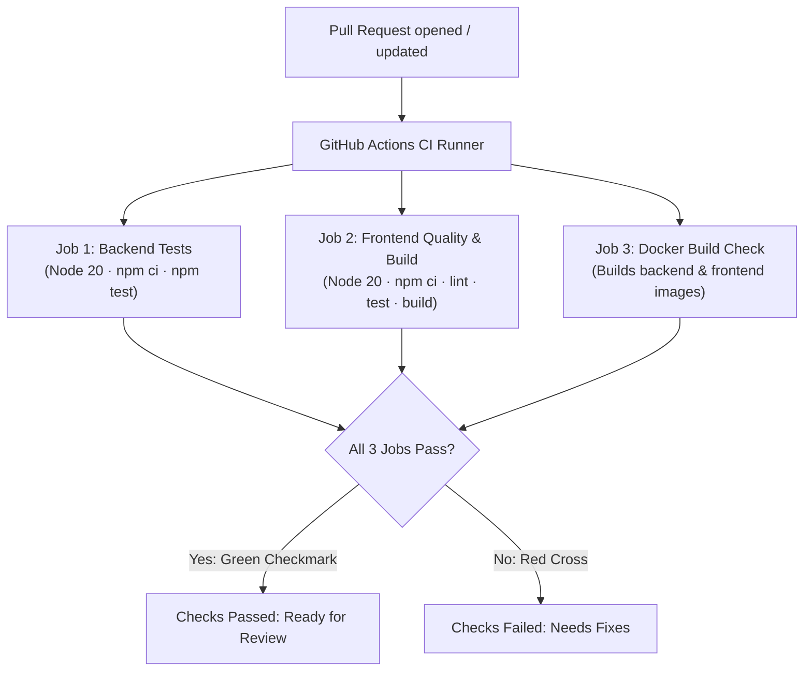

# Contributing to Mini Instagram

Welcome to the **Mini Instagram** university team project! This guide explains our team's Git collaboration workflow, branching strategy, code standards, and CI/CD verification process.

Following these practices ensures code quality, keeps our repository clean, and provides a clear audit trail for our university DevOps evaluation.

---

## 📌 Table of Contents
1. [Why Teammates Must Not Push Directly to `main`](#1-why-teammates-must-not-push-directly-to-main)
2. [Cloning the Repository](#2-cloning-the-repository)
3. [Git Branching Strategy](#3-git-branching-strategy)
4. [Writing Meaningful Commits](#4-writing-meaningful-commits)
5. [Running Local Verification & Tests](#5-running-local-verification--tests)
6. [Building Docker Images](#6-building-docker-images)
7. [Pushing Your Branch & Opening a Pull Request](#7-pushing-your-branch--opening-a-pull-request)
8. [How GitHub Actions CI Works](#8-how-github-actions-ci-works)

---

## 1. Why Teammates Must Not Push Directly to `main`

The `main` branch represents our **production-ready, deployable codebase**. Directly pushing code to `main` is strictly prohibited for the following reasons:

1. **Protects Working Software:** Direct pushes risk introducing broken builds, runtime exceptions, or failing tests into the stable branch that everyone depends on.
2. **Automated Quality Gates:** Pull Requests automatically trigger our GitHub Actions CI pipeline, running all 37 tests and Docker builds so the team can verify code health before merging.
3. **Peer Review & Knowledge Sharing:** Pull Requests give teammates the opportunity to review changes, catch bugs early, and understand how other parts of the application function.
4. **University Audit & Grading:** Evaluators grade teamwork based on our Git commit history, branch structure, and Pull Request discussions. Merging via PRs documents who authored each feature and why.
5. **Prevents Merge Conflicts:** Isolating work inside individual feature branches prevents teammates from accidentally overwriting each other's local changes.

---

## 2. Cloning the Repository

To get started, clone the official team repository to your local machine:

```bash
# Clone the repository
git clone https://github.com/AayanA20/DevOps_Project.git

# Navigate into the project root
cd DevOps_Project
```

Verify your remote connection:
```bash
git remote -v
```
You should see `https://github.com/AayanA20/DevOps_Project.git` listed for both `fetch` and `push`.

---

## 3. Git Branching Strategy

Never make changes on the `main` branch directly. Always create a dedicated branch for your task.

### Branch Naming Conventions:
* **Features:** `feature/<phase-or-feature-name>` (e.g., `feature/phase8-ci-cd`, `feature/user-stories`)
* **Bug Fixes:** `fix/<bug-description>` (e.g., `fix/jwt-expiration-handling`)
* **Documentation:** `docs/<topic>` (e.g., `docs/viva-preparation`)
* **Chores / Maintenance:** `chore/<task>` (e.g., `chore/dependency-updates`)

### Creating a New Feature Branch:
```bash
# 1. Ensure your local main is fully up to date
git checkout main
git pull origin main

# 2. Create and switch to your feature branch
git checkout -b feature/<feature-name>

# 3. Confirm you are on your feature branch
git branch
```

---

## 4. Writing Meaningful Commits

Our project follows the industry-standard **Conventional Commits** specification. This ensures our Git history is readable, structured, and professional.

### Format:
```text
<type>: <short description in present tense>
```

### Supported Types:
* `feat:` A new feature or capability (e.g., `feat: implement cursor pagination for home feed`)
* `fix:` A bug fix (e.g., `fix: resolve rate limiter header format`)
* `ci:` Changes to CI/CD workflows and automation (e.g., `ci: configure GitHub Actions test pipeline`)
* `docs:` Documentation additions or updates (e.g., `docs: add team contributing guide`)
* `test:` Adding or updating unit/integration tests (e.g., `test: add edge cases for JWT verification`)
* `chore:` Routine maintenance or dependency changes (e.g., `chore: update .gitignore for Windows system files`)

### Commit Guidelines:
* Keep the first line concise (under 72 characters).
* Use the imperative mood (e.g., "add", "fix", "implement", not "added" or "fixing").
* **Never commit secrets, credentials, or `.env` files.**

```bash
# Stage your modified files
git add <file-name>

# Commit with a meaningful conventional message
git commit -m "feat: add user notification center component"
```

---

## 5. Running Local Verification & Tests

Before pushing your branch, you must verify that all automated tests and quality checks pass locally on your machine.

### A. Backend Verification (26 Tests)
```bash
# Navigate to backend folder
cd backend

# Clean install dependencies
npm ci

# Run native test runner (node:test + supertest)
npm test
```
*Expected Output:* `ℹ tests 26 | pass 26 | fail 0`

### B. Frontend Verification (11 Tests + Lint + Build)
```bash
# Navigate to frontend folder
cd ../frontend

# Clean install dependencies
npm ci

# Run code linter
npm run lint

# Run Vitest component tests
npm test

# Verify production Vite build
npm run build
```
*Expected Output:* `Test Files 4 passed (4) | Tests 11 passed (11)` and `✓ built in ...` with zero errors.

---

## 6. Building Docker Images

Both frontend and backend include production Dockerfiles. Verify that container packaging completes without errors:

```bash
# From the project root:

# 1. Build backend Docker image
docker build -t mini-instagram-backend:ci ./backend

# 2. Build frontend Docker image (Nginx + Vite SPA)
docker build -t mini-instagram-frontend:ci ./frontend
```

To run the complete 4-service stack locally using Docker Compose:
```bash
docker compose up --build -d
docker compose ps
```

---

## 7. Pushing Your Branch & Opening a Pull Request

Once all local tests and builds succeed, push your feature branch to GitHub:

```bash
# Push branch to remote and set upstream tracking
git push -u origin feature/<feature-name>
```

### Steps to Open a Pull Request:
1. Navigate to the GitHub repository: `https://github.com/AayanA20/DevOps_Project`
2. Click the green **"Compare & pull request"** button for your newly pushed branch.
3. Verify that:
   * **Base branch:** `main`
   * **Compare branch:** `feature/<feature-name>`
4. The Pull Request description will automatically load our [PR Template](.github/pull_request_template.md).
5. Fill out all sections:
   * **Summary of Changes:** What was added or updated.
   * **Reason for Changes:** The business or architectural justification.
   * **Tests Performed:** Check off the tests you ran.
   * **Contributor Checklist:** Confirm no secrets are included and commit messages follow standards.
6. Click **"Create pull request"**.

---

## 8. How GitHub Actions CI Works

When a Pull Request is opened or updated, GitHub Actions automatically executes our pipeline defined in [`.github/workflows/ci.yml`](.github/workflows/ci.yml).

The pipeline launches **3 independent, parallel jobs**:



### Status Indicators & Merge Protection:
* 🟢 **All checks passed:** Your branch is healthy, builds succeed, and tests pass. A teammate can review and approve the merge into `main`.
* 🔴 **A check failed:** Click **"Details"** next to the failed job in GitHub to inspect the console logs, fix the issue locally, and push another commit to your feature branch. GitHub Actions will re-run automatically.

> [!IMPORTANT]
> **Understanding Merge Blocking:**
> - GitHub Actions **reports whether checks pass or fail** by displaying status badges on the Pull Request.
> - **Merge blocking is not enabled automatically:** preventing merges on failed checks requires configuring **Branch Protection Rules** or a **Repository Ruleset** in GitHub settings with *“Require status checks to pass before merging”* turned on.
> - If those settings are not configured in the repository, a failed check will display a red warning but may not automatically prevent someone with write access from clicking merge.
> - **Team Standard:** Regardless of whether branch protection is enforced by GitHub, our team standard is to **never merge a Pull Request while any CI checks are failing**.

---

## 🔒 Security Best Practices

* **Never commit `.env` files.** Always verify with `git status` that `.env` is ignored.
* Sensitive configurations (MongoDB credentials, JWT secrets, Cloudinary keys) belong in environment variables, never hardcoded in source files.
* If a secret is accidentally committed, notify the team immediately so it can be revoked and the Git history cleaned.
