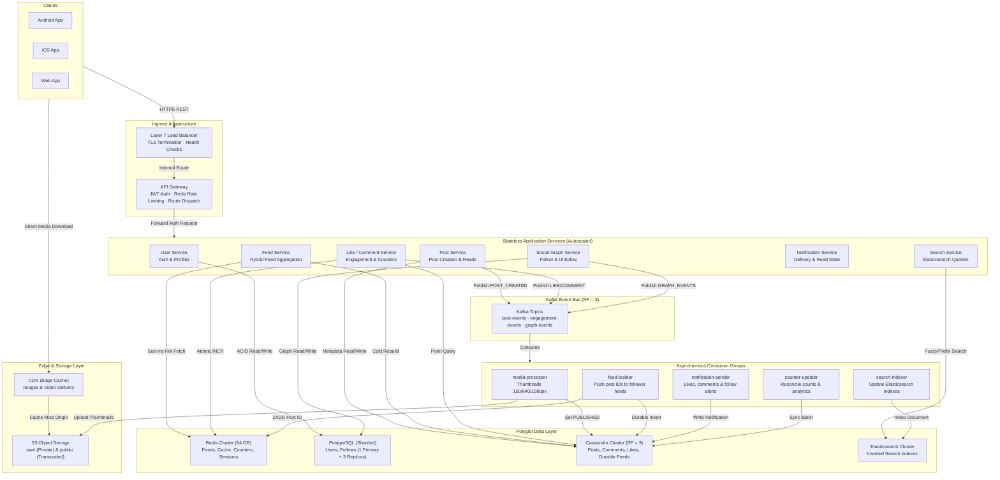
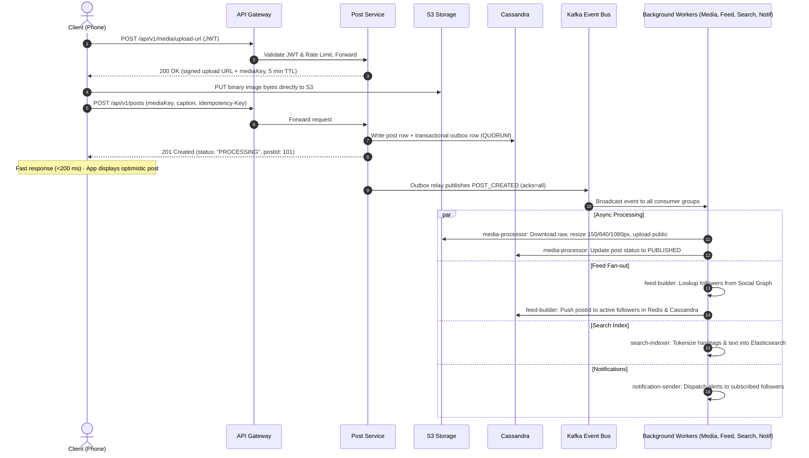

# Mini Instagram – Full-Stack Photo Sharing Platform & System Design
> **University DevOps & System Design Project (20 Marks)**  
> **Prepared by:** Shivani & Team · **Target Scale:** 10M registered users · 2M DAU  
> **System Design Document:** [docs/SYSTEM_DESIGN_PHASE_4_5.md](docs/SYSTEM_DESIGN_PHASE_4_5.md)

---

## 📸 Project Overview

**Mini Instagram** is a full-stack social media application and distributed system design project. It combines:
1. **Part A (System Design – Phase 4 & 5):** A comprehensive architectural design capable of handling **10M registered users, 2M Daily Active Users (DAU), 7,000 peak RPS**, polyglot persistence, Redis cache-aside caching, Kafka event streaming, and hybrid feed fan-out.
2. **Part B (DevOps Prototype):** A clean, modular, production-grade full-stack application (React + Vite + Tailwind CSS + Node.js Express + Mongoose) implementing versioned REST endpoints (`/api/v1`), Gateway rate limiting, idempotency keys, Redis-compatible caching, and asynchronous outbox event processing.

---

## 🏛️ System Architecture (Phase 5)

### High-Level Architecture (Figure 1)


### Request Lifecycle: Direct S3 Photo Upload (Figure 2)


---

## 📊 Capacity Baseline & Sizing (10M Users)

| Metric | Target Value | Architectural Sizing / Calculation |
| :--- | :--- | :--- |
| **Registered Users** | 10,000,000 | 10M user records |
| **Daily Active Users (DAU)** | 2,000,000 | ~20% of user base |
| **Requests / Day** | 200,000,000 | $2\text{M DAU} \times 100\text{ req/day}$ |
| **Average RPS** | ~2,315 RPS | $\frac{200{,}000{,}000}{86{,}400\text{ s}}$ |
| **Peak RPS (3x)** | ~7,000 RPS | Peak multiplier |
| **Application Containers** | ~21 instances | $\frac{7{,}000\text{ peak RPS}}{500\text{ RPS/container}} \times 1.5\text{ headroom} \approx 21$ across 3 AZs |
| **New Posts / Day** | 200,000 posts | ~10% of DAU post daily |
| **Media Storage / Year** | ~146 TB / year | $200{,}000 \times 2\text{ MB} \times 365 \approx 146\text{ TB/year}$ |
| **Post Metadata / Year** | ~73 GB / year | $200{,}000 \times 1\text{ KB} \times 365 \approx 73\text{ GB/year}$ (~220 GB at RF=3) |
| **Redis Feed Cluster Memory** | ~64 GB | $2\text{M DAU} \times 800\text{ IDs} \times 40\text{ bytes} \approx 64\text{ GB}$ (4x 16 GB nodes) |

---

## ⚡ Phase 4 REST API Specifications (`/api/v1`)

All endpoints use base path `/api/v1` and standard HTTP status codes:

| Method | Endpoint | Description | Auth Required |
| :--- | :--- | :--- | :--- |
| `POST` | `/api/v1/auth/signup` | Register new account (returns `userId`, `accessToken`, `refreshToken`) | No |
| `POST` | `/api/v1/auth/login` | Log in and receive access + refresh tokens | No |
| `POST` | `/api/v1/auth/logout` | Invalidate refresh token session | Yes |
| `GET` | `/api/v1/auth/me` | Fetch authenticated user profile | Yes |
| `POST` | `/api/v1/media/upload-url` | Get short-lived presigned upload URL for direct S3 upload | Yes |
| `POST` | `/api/v1/posts` | Create post (`status: PROCESSING`, supports `Idempotency-Key`) | Yes |
| `GET` | `/api/v1/posts/:id` | Fetch post details (cached in Redis `post:{postId}`) | No |
| `DELETE` | `/api/v1/posts/:id` | Delete post (owner only, invalidates cache) | Yes |
| `GET` | `/api/v1/feed` | Hybrid home feed with cursor pagination (`?cursor=...&limit=20`) | Optional |
| `POST` | `/api/v1/posts/:id/like` | Idempotent like (atomic `INCR` on `likes:count:{postId}`) | Yes |
| `DELETE` | `/api/v1/posts/:id/like` | Idempotent unlike | Yes |
| `POST` | `/api/v1/posts/:id/comments` | Add comment to post | Yes |
| `GET` | `/api/v1/posts/:id/comments` | List comments for a post | No |
| `GET` | `/api/v1/users/:id` | Get user profile with follower/following counts | No |
| `PATCH` | `/api/v1/users/me` | Update bio or profile avatar | Yes |
| `POST` | `/api/v1/users/:id/follow` | Idempotent follow (dispatches feed backfill event) | Yes |
| `DELETE` | `/api/v1/users/:id/follow` | Unfollow user | Yes |
| `GET` | `/api/v1/users/:id/followers` | List followers of user | No |
| `GET` | `/api/v1/users/:id/posts` | User profile grid posts | No |
| `GET` | `/api/v1/notifications` | List user notifications | Yes |
| `GET` | `/api/v1/search` | Search users or hashtags (`?q=&type=user\|hashtag`) | No |
| `POST` | `/api/v1/stories` | Create ephemeral 24-hour story | Yes |
| `GET` | `/api/v1/system/architecture`| Real-time capacity specifications and live engine telemetry | No |

### Standard Error Response Shape
```json
{
  "error": {
    "code": "POST_NOT_FOUND",
    "message": "The requested post does not exist"
  }
}
```

---

## 🛠️ Implemented Architectural Components

1. **Redis Cache-Aside Service (`backend/services/cacheService.js`):**
   - Implements Redis sorted sets (`feed:{userId}`), hashes (`post:{postId}`, `user:{userId}`), and atomic counters (`likes:count:{postId}`).
   - Embedded high-performance in-memory LRU store with automatic fallback when Redis cluster is offline.
2. **Asynchronous Kafka Event Bus (`backend/services/eventBus.js`):**
   - Topics: `post-events`, `engagement-events`, `graph-events`.
   - Transactional Outbox pattern emulation.
   - At-least-once delivery with `eventId` deduplication (idempotent consumers).
   - Retry queue with exponential backoff and Dead-Letter Queue (`post-events.dlq`).
   - Consumers: `media-processor`, `feed-builder`, `search-indexer`, `notification-sender`, `counter-updater`.
3. **Gateway Rate Limiter (`backend/middleware/rateLimiter.js`):**
   - Enforces 100 requests/minute per user/IP using sliding window counters.
   - Sets `X-RateLimit-*` and `Retry-After` headers on HTTP 429.
4. **Idempotency Protection (`backend/middleware/idempotency.js`):**
   - Checks `Idempotency-Key` headers on write requests to prevent duplicate posts on poor mobile network retries.

---

## 🚀 Running the Project

### Prerequisites
- Node.js (v18+)
- npm (v9+)

### 1. Run Backend
```bash
cd backend
npm install
npm test            # Runs complete test suite (15/15 passing)
npm run dev         # Starts server on http://localhost:5000
```

### 2. Run Frontend
```bash
cd frontend
npm install
npm run build       # Bundles production Vite build (0 errors)
npm run dev         # Launches Vite dev server on http://localhost:5173
```

---

## 🧪 Automated Test Verification

Run automated tests inside `backend/`:
```bash
npm test
```
**Output:**
```
✔ GET /health returns healthy status code 200
✔ GET /api/health returns service identification
✔ GET / returns API welcome info and route index
✔ POST /api/auth/register with missing fields returns 400
✔ POST /api/auth/login with empty fields returns 400
✔ GET non-existent route returns 404
✔ GET /api/v1/system/architecture returns capacity baseline and polyglot specs
✔ POST /api/v1/auth/signup with missing fields returns 400 with standardized error shape
✔ POST /api/v1/auth/login with missing credentials returns 400 with standardized error shape
✔ POST /api/v1/media/upload-url without JWT returns 401 UNAUTHORIZED
✔ GET /api/v1/feed returns 200 with posts array and nextCursor property
✔ GET /api/v1/search handles query and returns results
✔ Rate limiting headers are present on API responses
✔ CacheService verifies Redis Sorted Sets & Hash operations (Section 4D)
✔ EventBus publishes to Kafka topics with outbox pattern and deduplication (Section 5D)

ℹ tests 15 | suites 0 | pass 15 | fail 0 | cancelled 0
```

---

## 🎓 University Viva Quick Answers

1. **Why an API Gateway?**  
   It terminates TLS, checks JWT authentication once, enforces the 100 req/min rate limit, and routes traffic. This prevents abusive requests from overloading internal microservices.
2. **Why direct-to-S3 uploads with signed URLs?**  
   Uploading 2 MB photos through application servers consumes memory, CPU, and sockets. Signed URLs allow phones to upload directly to S3, keeping API response latency under 200 ms.
3. **What happens if Kafka is down?**  
   Posts and likes are saved safely in the primary store along with an outbox record (Transactional Outbox pattern). Once Kafka recovers, the relay resumes dispatching events without any data loss.
4. **Why microservices for system design but a monolith for the mini project?**  
   Microservices are designed for 10M users and multi-team scaling. For a university DevOps submission, a modular monolithic architecture (React, Express, MongoDB) is vastly faster to develop, test, containerize, and deploy within CI/CD pipelines.
