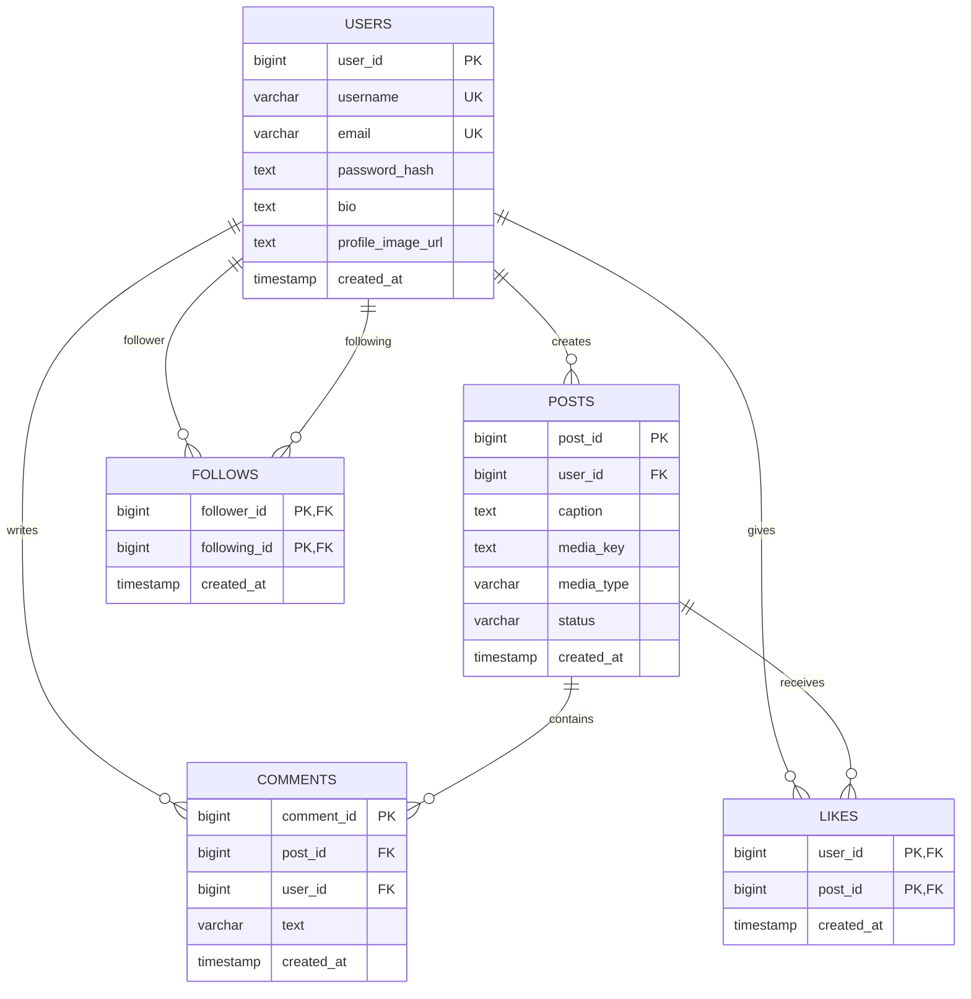
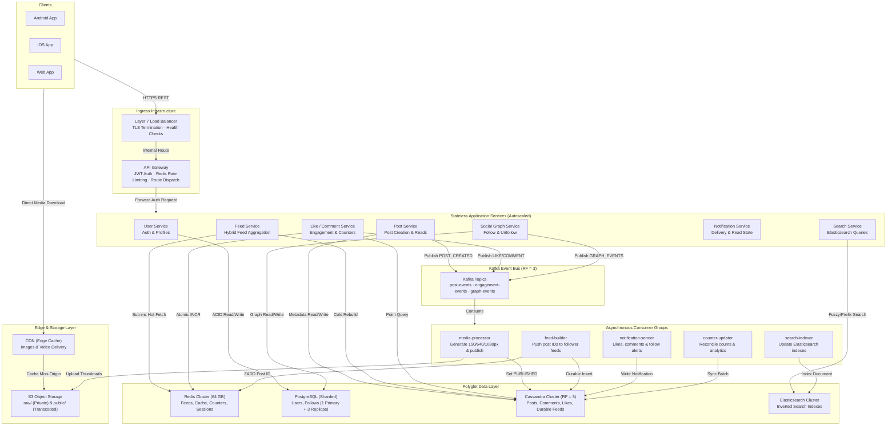
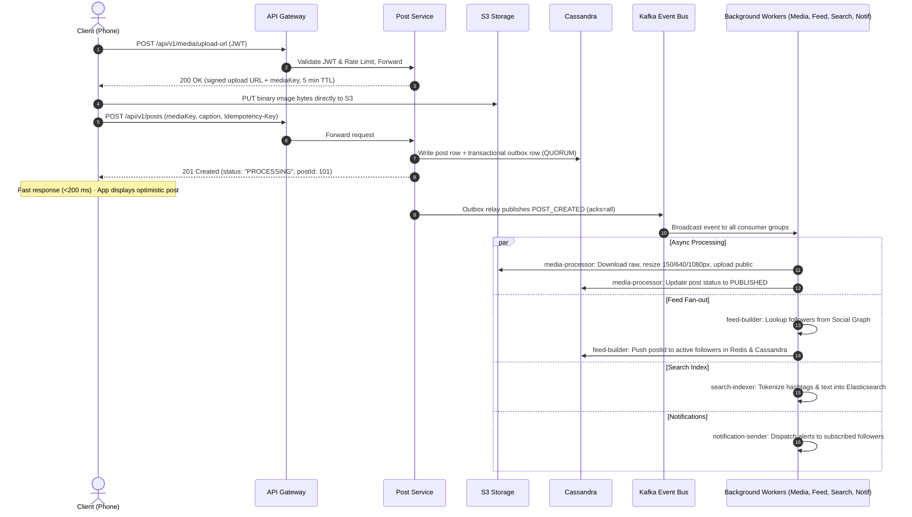
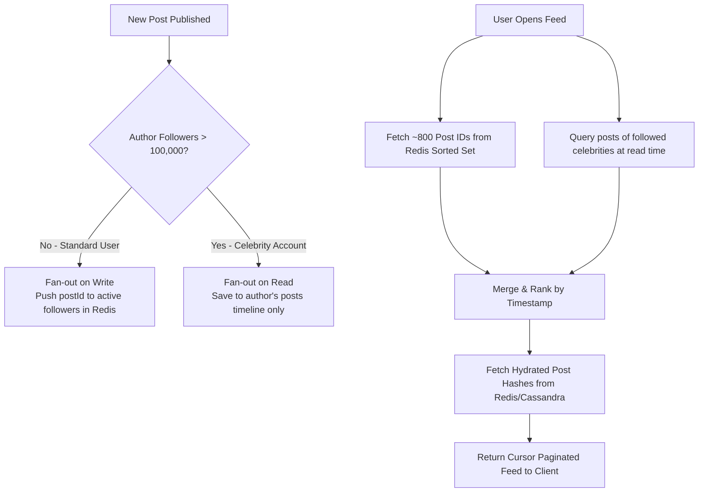

# Instagram System Design – Phase 4 & 5
**Date:** 6 November 2026 · **Prepared by:** Shivani  
**Target Scale:** 10M registered users · 2M Daily Active Users (DAU)  
**Document Scope:** Phase 4 (REST API & Data Model) and Phase 5 (High-Level Architecture, Scalability, Caching, Sharding, Consistency, Kafka & Feed Fan-out)

---

## Executive Summary & Capacity Baseline

This design covers the architecture, API contracts, polyglot data models, and distributed systems mechanisms required to sustain a modern photo-sharing platform at 10M registered users with high availability (99.9%) and responsive p95 feed latencies (< 300 ms).

### Capacity Baseline (Derived from Phase 2 Estimates)
| Metric | Baseline Value | Sizing Formula / Assumption |
| :--- | :--- | :--- |
| **Total Registered Users** | 10,000,000 | 10M user accounts |
| **Daily Active Users (DAU)** | 2,000,000 | ~20% of registered base |
| **Requests per DAU per Day** | 100 requests | Feed scrolling, profile views, likes, comments |
| **Total Requests per Day** | 200,000,000 | $2\text{M DAU} \times 100\text{ req} = 200\text{M req/day}$ |
| **Average Throughput (RPS)** | ~2,315 RPS | $\frac{200,000,000}{86,400\text{ sec}} \approx 2,315\text{ RPS}$ |
| **Peak Throughput (RPS)** | ~7,000 RPS | Assumed $3\times$ peak traffic multiplier |
| **New Posts per Day** | 200,000 posts | ~10% of DAU post once per day |
| **Average Media Payload** | 2 MB per image | Compressed original uploads |
| **Original Media Storage per Year** | ~146 TB / year | $200,000 \times 2\text{ MB} \times 365 \approx 146\text{ TB/year}$ |
| **Post Metadata Storage per Year** | ~73 GB / year | $200,000 \times 1\text{ KB} \times 365 \approx 73\text{ GB/year}$ (~220 GB at RF=3) |
| **Engagement Rate** | ~40,000,000 events/day | 20 likes/comments per DAU per day (~463 events/sec avg, ~1,400 peak) |

---

## 4A. API Design

We use versioned REST over HTTPS with JSON request and response payloads. Authentication is strictly enforced via JSON Web Tokens (JWT) in the `Authorization: Bearer <token>` header, verified at the API Gateway.

### Core Conventions
1. **Base Path:** `/api/v1` for all endpoints.
2. **Identities:** 64-bit Snowflake-style integers: monotonically time-sortable and decentralized without a single-point-of-failure auto-increment counter.
3. **Cursor Pagination:** `?cursor=<created_at_epoch>_<postId>&limit=20` instead of offset/page pagination. Prevents skipped or repeated posts during live timeline shifts.
4. **Idempotent Writes:** Retries for like, follow, and post creation are safe. `POST /api/v1/posts` accepts an `Idempotency-Key: <uuid>` header to prevent network duplicates.
5. **Standardized Error Format:**
   ```json
   {
     "error": {
       "code": "POST_NOT_FOUND",
       "message": "The requested post could not be located"
     }
   }
   ```
   Standard HTTP status codes: `400 Bad Request`, `401 Unauthorized`, `403 Forbidden`, `404 Not Found`, `409 Conflict`, `429 Too Many Requests`.
6. **Rate Limiting:** 100 requests/minute per user/IP enforced at the API Gateway using sliding window Redis counters. Exceeding limits returns `429 Too Many Requests` with a `Retry-After: <seconds>` header.
7. **Zero-Byte App Server Uploads:** Clients request a short-lived signed URL via `POST /media/upload-url` and upload photo bytes directly to Amazon S3. Large binary payloads never touch application servers.

### Comprehensive REST Endpoint Table
| Method | Endpoint | Purpose | Auth | Success Code |
| :--- | :--- | :--- | :--- | :--- |
| **POST** | `/api/v1/auth/signup` | Register a new user | No | `201 Created` |
| **POST** | `/api/v1/auth/login` | Authenticate, receive access & refresh tokens | No | `200 OK` |
| **POST** | `/api/v1/auth/logout` | Invalidate refresh token session | Yes | `204 No Content` |
| **GET** | `/api/v1/users/{id}` | Get user profile with follower/following counters | Yes | `200 OK` |
| **PATCH** | `/api/v1/users/me` | Update personal bio or profile avatar | Yes | `200 OK` |
| **POST** | `/api/v1/media/upload-url` | Generate short-lived signed S3 upload URL | Yes | `200 OK` |
| **POST** | `/api/v1/posts` | Create post after client S3 direct upload | Yes | `201 Created` |
| **GET** | `/api/v1/posts/{id}` | Get post details and author metadata | Yes | `200 OK` |
| **DELETE** | `/api/v1/posts/{id}` | Delete owned post | Yes | `204 No Content` |
| **GET** | `/api/v1/feed` | Home feed (cursor paginated) | Yes | `200 OK` |
| **GET** | `/api/v1/users/{id}/posts` | User profile grid posts (newest first) | Yes | `200 OK` |
| **POST** | `/api/v1/posts/{id}/like` | Like a post (idempotent) | Yes | `200 OK` |
| **DELETE** | `/api/v1/posts/{id}/like` | Unlike a post (idempotent) | Yes | `204 No Content` |
| **POST** | `/api/v1/posts/{id}/comments` | Add a comment to a post | Yes | `201 Created` |
| **GET** | `/api/v1/posts/{id}/comments` | List comments of a post (oldest first) | Yes | `200 OK` |
| **POST** | `/api/v1/users/{id}/follow` | Follow a user (idempotent) | Yes | `200 OK` |
| **DELETE** | `/api/v1/users/{id}/follow` | Unfollow a user (idempotent) | Yes | `204 No Content` |
| **GET** | `/api/v1/users/{id}/followers` | List user followers | Yes | `200 OK` |
| **GET** | `/api/v1/notifications` | List user notifications | Yes | `200 OK` |
| **GET** | `/api/v1/search?q=&type=user\|hashtag`| Search users or hashtag content | Yes | `200 OK` |
| **POST** | `/api/v1/stories` | Create ephemeral 24-hour story | Yes | `201 Created` |

---

## 4B. Request & Response Examples

### 1. Signup (`POST /api/v1/auth/signup`)
```http
POST /api/v1/auth/signup HTTP/1.1
Content-Type: application/json

{
  "username": "shivani_r",
  "email": "shivani@example.com",
  "password": "S3cure#Password123"
}
```
**Response (201 Created):**
```json
{
  "userId": 25,
  "username": "shivani_r",
  "accessToken": "eyJhbGciOiJIUzI1NiIsInR5cCI6IkpXVCJ9...",
  "refreshToken": "d9f1a8c2-3e4b-4a5f-9c8d-7b6a5e4d3c2b"
}
```
**Response (409 Conflict):**
```json
{
  "error": {
    "code": "USERNAME_TAKEN",
    "message": "Username already exists"
  }
}
```

### 2. Get Upload URL (`POST /api/v1/media/upload-url`)
```http
POST /api/v1/media/upload-url HTTP/1.1
Authorization: Bearer eyJhbGciOi...
Content-Type: application/json

{
  "mediaType": "IMAGE",
  "contentType": "image/jpeg",
  "sizeBytes": 2048000
}
```
**Response (200 OK):**
```json
{
  "uploadUrl": "https://bucket.s3.amazonaws.com/raw/abc123_uuid.jpg?X-Amz-Signature=...",
  "mediaKey": "raw/abc123_uuid.jpg",
  "expiresInSeconds": 300
}
```

### 3. Create Post (`POST /api/v1/posts`)
```http
POST /api/v1/posts HTTP/1.1
Authorization: Bearer eyJhbGciOi...
Idempotency-Key: a4e12c8b-59d2-4e08-9b7e-9823fca849b1
Content-Type: application/json

{
  "caption": "My first post! #hello",
  "mediaKey": "raw/abc123_uuid.jpg",
  "mediaType": "IMAGE"
}
```
**Response (201 Created):**
```json
{
  "postId": 101,
  "userId": 25,
  "status": "PROCESSING",
  "createdAt": "2026-11-06T10:00:00Z"
}
```
*Note: Post status remains `PROCESSING` until the asynchronous media consumer generates thumbnails and promotes the media to `PUBLISHED`.*

### 4. Home Feed (`GET /api/v1/feed?limit=20&cursor=1793959200_101`)
```json
{
  "posts": [
    {
      "postId": 101,
      "user": {
        "userId": 25,
        "username": "shivani_r"
      },
      "caption": "My first post! #hello",
      "mediaUrl": "https://cdn.example.com/p/101_1080.jpg",
      "likeCount": 12,
      "commentCount": 3,
      "likedByMe": false,
      "createdAt": "2026-11-06T10:00:00Z"
    }
  ],
  "nextCursor": "1793959200_101"
}
```

### 5. Like / Unlike (`POST / DELETE /api/v1/posts/101/like`)
```json
{
  "postId": 101,
  "liked": true,
  "likeCount": 13
}
```

### 6. Add Comment (`POST /api/v1/posts/101/comments`)
```json
{
  "commentId": 5001,
  "postId": 101,
  "userId": 31,
  "text": "Nice photo!",
  "createdAt": "2026-11-06T10:05:00Z"
}
```

### 7. Follow User (`POST /api/v1/users/42/follow`)
```json
{
  "followerId": 25,
  "followingId": 42,
  "status": "FOLLOWING"
}
```

---

## 4C. Database Choice per Data Type (Polyglot Persistence)

No single monolithic database meets the demands of relational integrity, high-throughput timelines, distributed counters, and low-latency full-text queries.

| Data Type | Primary Store | Access Pattern | Why Chosen | Impact if Removed |
| :--- | :--- | :--- | :--- | :--- |
| **Users, Auth, Profiles** | **PostgreSQL** | Primary key lookup, uniqueness check on email/username | ACID transactions and unique constraints eliminate duplicate accounts | Inconsistent identities and duplicate usernames |
| **Social Graph (Follows)** | **PostgreSQL** (sharded) | "Who do I follow?" / "Who follows me?" | Strong consistency for relational state; bidirectional indexing | Inconsistent feed generation and broken privacy boundaries |
| **Posts & Comments** | **Cassandra** | High write throughput; queried by user & timestamp | Linear horizontal scalability, append-only sequential writes, zero SPOF | Single RDBMS primary bottlenecks; forced early sharding |
| **Likes (Relationship)** | **Cassandra** | Point lookups: `did user X like post Y?` | Extremely high volume key-value reads/writes | Database saturation on viral posts |
| **Home Feed Post IDs** | **Redis** (Hot) + **Cassandra** (Durable) | Read newest 20 IDs on app launch | In-memory sub-millisecond reads; Cassandra provides durable rebuild source | Every feed load hits disk; p95 latency exceeds 300 ms SLA |
| **Sessions, Rate Limits, Counters**| **Redis** | High-frequency atomic increments & TTL expirations | Atomic `INCR`/`EXPIRE` operations with sub-ms latency | Rate limit checks overload primary database |
| **Photos & Videos** | **Amazon S3** + **CDN** | Write once, read heavily from edge | Durable, cheap object storage; edge caching lowers egress costs | S3 bandwidth bill explodes; edge latency degrades |
| **User & Hashtag Search** | **Elasticsearch** | Prefix matching, fuzzy text queries | Inverted indexes fed asynchronously from Kafka events | Expensive `LIKE '%query%'` table scans destroy RDBMS performance |

---

## 4D. Schemas, Indexes and ER Model

### Entity-Relationship Diagram



### PostgreSQL DDL (Accounts & Social Graph)
```sql
CREATE TABLE users (
  user_id BIGINT PRIMARY KEY,
  username VARCHAR(50) NOT NULL UNIQUE,
  email VARCHAR(100) NOT NULL UNIQUE,
  password_hash TEXT NOT NULL,          -- bcrypt hash
  bio TEXT,
  profile_image_url TEXT,
  created_at TIMESTAMPTZ NOT NULL DEFAULT now()
);

CREATE TABLE follows (
  follower_id  BIGINT NOT NULL REFERENCES users(user_id),
  following_id BIGINT NOT NULL REFERENCES users(user_id),
  created_at   TIMESTAMPTZ NOT NULL DEFAULT now(),
  PRIMARY KEY (follower_id, following_id),
  CHECK (follower_id <> following_id)
);

-- Primary key satisfies "Who do I follow?"; index satisfies "Who follows me?"
CREATE INDEX idx_follows_following ON follows (following_id, follower_id);
```

### Logical Tables for Posts, Likes & Comments
```sql
CREATE TABLE posts (
  post_id BIGINT PRIMARY KEY,
  user_id BIGINT NOT NULL REFERENCES users(user_id),
  caption TEXT,
  media_key TEXT NOT NULL,              -- S3 object key
  media_type VARCHAR(10) NOT NULL,      -- IMAGE | VIDEO
  status VARCHAR(12) NOT NULL,          -- PROCESSING | PUBLISHED
  created_at TIMESTAMPTZ NOT NULL DEFAULT now()
);

CREATE INDEX idx_posts_user_time ON posts (user_id, created_at DESC);

CREATE TABLE likes (
  user_id BIGINT NOT NULL,
  post_id BIGINT NOT NULL,
  created_at TIMESTAMPTZ NOT NULL DEFAULT now(),
  PRIMARY KEY (user_id, post_id)
);

CREATE TABLE comments (
  comment_id BIGINT PRIMARY KEY,
  post_id BIGINT NOT NULL,
  user_id BIGINT NOT NULL,
  text VARCHAR(2200) NOT NULL,
  created_at TIMESTAMPTZ NOT NULL DEFAULT now()
);

CREATE INDEX idx_comments_post_time ON comments (post_id, created_at);
```

### Cassandra Query-Driven Data Models
```sql
-- Profile grid, sorted newest first
CREATE TABLE posts_by_user (
  user_id BIGINT,
  created_at TIMESTAMP,
  post_id BIGINT,
  caption TEXT,
  media_key TEXT,
  media_type TEXT,
  PRIMARY KEY ((user_id), created_at, post_id)
) WITH CLUSTERING ORDER BY (created_at DESC, post_id DESC);

-- Durable feed store per user
CREATE TABLE feed_by_user (
  user_id BIGINT,
  created_at TIMESTAMP,
  post_id BIGINT,
  PRIMARY KEY ((user_id), created_at, post_id)
) WITH CLUSTERING ORDER BY (created_at DESC, post_id DESC);

-- Likes lookup: single partition per post
CREATE TABLE likes_by_post (
  post_id BIGINT,
  user_id BIGINT,
  created_at TIMESTAMP,
  PRIMARY KEY ((post_id), user_id)
);

-- Comments on a post: chronological
CREATE TABLE comments_by_post (
  post_id BIGINT,
  created_at TIMESTAMP,
  comment_id BIGINT,
  user_id BIGINT,
  text TEXT,
  PRIMARY KEY ((post_id), created_at, comment_id)
);
```

### Redis Key Design & Memory Estimation
| Redis Key Pattern | Data Type | Purpose | TTL |
| :--- | :--- | :--- | :--- |
| `feed:{userId}` | Sorted Set (score = timestamp) | Latest ~800 post IDs for user feed | Trimmed (no TTL) |
| `post:{postId}` | Hash | Caption, mediaKey, authorId, counts | 1 Hour |
| `user:{userId}` | Hash | Profile fields (username, avatar, bio) | 1 Hour |
| `likes:count:{postId}` | Counter (Integer) | Displayed like count | None |
| `session:{token}` | String | Authenticated userId session | 7 Days |
| `rate:{userId}:{minute}` | Counter (Integer) | Gateway rate limit sliding window | 60 Seconds |

> **Memory Sizing Assumption:**  
> A Sorted Set entry costs ~40 bytes in Redis.  
> Storing 800 post IDs for 2M Daily Active Users:  
> $$2{,}000{,}000 \text{ DAU} \times 800 \text{ entries} \times 40\text{ bytes} \approx 64\text{ GB}$$  
> 64 GB is easily managed across a 4-node Redis cluster (16 GB per node) with $1:1$ replica pairs. Inactive users are evicted via LRU and rebuilt on demand from Cassandra.

---

## 5A. High-Level Architecture

### Core System Principles
1. **Stateless Services:** Application services retain zero state in local memory, enabling autoscaling and dynamic load distribution across availability zones.
2. **Asynchronous Slow Work:** Media transcoding, feed distribution, notifications, and search indexing are decoupled through Kafka.
3. **Zero-Byte Media Passthrough:** Binary media flows directly from client to S3 and from S3/CDN to client.
4. **Polyglot Persistence:** Specialized storage engines tailored to specific query and scale characteristics.
5. **Horizontal Scalability:** All application and data tiers scale horizontally via partitioning and replication.

### System Architecture Diagram (Figure 1)



### Request Lifecycle: Photo Upload Flow (Figure 2)



---

## 5B. Caching, Read Replicas, Sharding and CDN

### 1. Redis Caching Strategy (Cache-Aside)
- **Read Path:** Application queries Redis first. On miss, it fetches from Cassandra/PostgreSQL, caches in Redis with a 1-hour TTL, and returns.
- **Write Path / Invalidation:** When a post or profile is modified or deleted, the corresponding cache key is purged immediately.
- **Cache Stampede Prevention:** Mutex locks (e.g. `SETNX` lock with a 2-second timeout) prevent concurrent backend hits when hot keys expire.
- **Eviction Policy:** `allkeys-lru` evicts the least recently accessed keys when 64 GB memory capacity is approached.

### 2. Read Replicas (PostgreSQL)
- Profile lookups and relationship checks are served from 2–3 read replicas with asynchronous streaming replication.
- **Read-Your-Own-Writes Guarantee:** When a user updates their own bio, their immediate subsequent read is directed to the primary instance to eliminate replica lag perception.

### 3. Sharding Architecture
| Data Entity | Store | Shard Key | Strategy & Hotspot Mitigation |
| :--- | :--- | :--- | :--- |
| **Posts & Feeds** | Cassandra | `user_id` (partition key) | Colocates a user's posts in a single partition. Large accounts bucketed by `(user_id, yyyy_mm)`. |
| **Follows** | PostgreSQL | `follower_id` | Colocates "Who do I follow?". A secondary indexed projection keyed by `following_id` satisfies "Who follows me?". |
| **Likes / Comments** | Cassandra | `post_id` | Colocates likes per post. Viral post counters are sharded across sub-keys (`likes:count:post:part_{1..10}`) in Redis. |

### 4. CDN & Edge Media Acceleration
- Media is permanently immutable; URL keys change on revision (`/p/101_1080.jpg?v=1`).
- Cache-Control headers set to `public, max-age=31536000, immutable`.
- Edge caching eliminates ~95% of traffic hitting the origin S3 bucket.

---

## 5C. Consistency Model (CAP Trade-offs)

Under network partition conditions, we choose **Availability** for reads, feeds, and engagement, and **Consistency** for accounts, authentication, and core relationships.

| Operation | Level | Mechanism | Justification |
| :--- | :--- | :--- | :--- |
| **User Registration** | **Strong** | PostgreSQL primary ACID unique constraints | Prevents identical usernames or duplicate accounts |
| **Session Authentication** | **Strong** | Redis string lookup + PostgreSQL primary validation | Immediate invalidation upon logout or token revocation |
| **Follow / Unfollow** | **Strong** | Composite primary key `(follower_id, following_id)` | Prevents duplicate relationships and invalid access states |
| **Post Creation Metadata** | **Strong** | Cassandra quorum write ($W=\text{QUORUM}$) | Acknowledged post creation must never be lost |
| **Like Relationship** | **Strong** | Primary key `(post_id, user_id)` in Cassandra | Prevents duplicate likes from the same user |
| **Like & Comment Counts** | **Eventual** | In-memory atomic Redis `INCR`, background sync | Showing 1,203 instead of 1,205 is imperceptible to users |
| **Home Timeline (Feed)** | **Eventual** | Built asynchronously from Kafka `POST_CREATED` | A 1–2 second propagation delay is acceptable |
| **Search Index** | **Eventual** | Asynchronous Elasticsearch indexer worker | Hashtags become searchable within seconds |
| **CDN Invalidation** | **Eventual** | Immutable asset keys | Zero stale-asset invalidation race conditions |

---

## 5D. Asynchronous Processing with Kafka

### Topic Layout & Partitioning
| Topic Name | Partition Key | Producer | Consumer Groups |
| :--- | :--- | :--- | :--- |
| `post-events` | `user_id` (author) | Post Service | `feed-builder`, `media-processor`, `search-indexer`, `analytics` |
| `engagement-events` | `post_id` | Like/Comment Service | `notification-sender`, `counter-updater`, `analytics` |
| `graph-events` | `following_id` | Social Graph Service| `feed-builder` (backfill), `notification-sender` |

### Reliability & Resiliency
1. **Transactional Outbox Pattern:** The Post Service writes post data and an outbox entry in a single atomic transaction. A CDC (Change Data Capture) relay publishes the event to Kafka, ensuring zero message loss.
2. **At-Least-Once Delivery:** Consumer groups commit offsets only after successfully processing and writing to target stores.
3. **Idempotent Consumers:** Consumers check `eventId` against Redis cache before execution; duplicate delivery produces no side effects.
4. **Dead-Letter Queues (DLQ):** Failed events retry 3 times with exponential backoff (1s, 10s, 60s) before routing to `post-events.dlq` for manual inspection.

---

## 5E. Feed Fan-Out, Bottlenecks & Trade-offs

### Hybrid Fan-out Mechanism
- **Fan-out on Write (Push):** For standard users ($< 100{,}000$ followers), post IDs are immediately pushed to active followers' Redis sorted sets.
- **Fan-out on Read (Pull):** For celebrity / high-follower accounts ($> 100{,}000$ followers), posts are not pushed to millions of mailboxes. When a user requests their feed, celebrity posts are fetched at read time and merged with the pushed timeline.



### Bottleneck Mitigation Matrix
| Bottleneck / Failure | Concrete Symptom | Architectural Mitigation | Trade-off / Cost |
| :--- | :--- | :--- | :--- |
| **Celebrity Post Storm** | Million-write spikes on upload | Hybrid fan-out (pull celebrity posts at read time) | Slight compute cost at read time during merge |
| **Feed Latency Degradation** | Feed p95 exceeds 300 ms SLA | Redis sorted sets + pipelined batch hash hydration | Cache memory cost (~64 GB cluster) |
| **Hot Database Shard** | Viral post saturates single node | Partitioned counter keys in Redis (`likes:count:post:part_N`) | Counts reconciled eventually across keys |
| **Media Bandwidth Costs** | Huge egress fees from origin S3 | CloudFront/Edge CDN + WebP/responsive compression | Additional storage for multi-size renditions |
| **Kafka Consumer Lag** | Feeds update minutes late | Increase partition count + autoscale consumer containers | Strict ordering guaranteed only per partition |
| **Redis Node Outage** | Cache stampede hits Cassandra | Master-replica failover + short mutex locking on rebuild | Slower read latency during warm-up phase |
| **Complete Region Failure** | Service unreachable | Multi-AZ deployment now; multi-region active-passive planned | Higher infrastructure cost and replication complexity |

---

## 4F. Instagram's Real Documented Architecture: Historical vs. Modern Meta Infrastructure

To distinguish real-world engineering from common online tutorial simplifications, this section examines the actual technologies Instagram has deployed throughout its engineering history, citing publicly available engineering blogs and official Meta documentation.

### Architectural Classification Legend
* 🏛️ **[HISTORICAL (2010–2014)]**: Publicly documented technologies used by Instagram during its independent AWS startup era.
* 🔄 **[LATER ARCHITECTURE (2014–2020)]**: Technologies developed or deployed post-acquisition as scale surged to hundreds of millions.
* ⚡ **[CURRENTLY CONFIRMED (2020–Present)]**: Technologies confirmed by Meta Engineering to power Instagram's modern production infrastructure.
* 🎓 **[PROPOSED FOR MINI INSTAGRAM]**: Architectural patterns adopted specifically for our university educational project.

---

### Detailed Technology Breakdown

#### 1. Python and Django
* **Classification:** ⚡ **[CURRENTLY CONFIRMED]**
* **What it does:** Python is a dynamic high-level programming language; Django is a batteries-included web framework providing routing, ORM, and authentication middleware.
* **Why Instagram used it:** In 2010, co-founders Kevin Systrom and Mike Krieger selected Django for development speed. Instagram scaled to 30 million users with fewer than 15 engineers because Django allowed instant feature iteration without compilation cycles.
* **Engineering Problem Addressed:** High developer velocity and fast shipping cycles during explosive hyper-growth.
* **Current Meta Status:** Instagram continues to operate the world’s largest Django deployment. The application tier runs on a custom high-performance runtime called **Cinder** (Meta’s internal performance-oriented Python fork featuring a Method JIT, shadow bytecode compilation, and eager coroutine execution).
* **Reliable Sources:** 
  * Meta Engineering Blog: *"Web Service Efficiency at Instagram with Python"* (2016)
  * Meta Engineering: *"Open-sourcing Cinder, a performance-oriented Python fork"* (2022)

#### 2. PostgreSQL & Custom Sharding
* **Classification:** 🏛️ **[HISTORICAL (2010–2014)]**
* **What it does:** Robust, ACID-compliant open-source relational database management system.
* **Why Instagram used it:** Served as Instagram's primary data store in early architecture (2010–2012) for users, media metadata, auth, and tags.
* **Engineering Problem Addressed:** Relational integrity and predictable indexing. When data volume exceeded a single server, Instagram pioneered client-side application sharding across dozens of PostgreSQL instances using PL/pgSQL functions and custom 64-bit **Snowflake IDs**:
  $$\text{ID} = [41 \text{ bits: timestamp epoch}] + [13 \text{ bits: shard ID}] + [10 \text{ bits: auto-increment sequence}]$$
* **Current Meta Status:** Most relational workloads were migrated into Meta's internal globally distributed data stores (TAO and ZippyDB) post-acquisition.
* **Reliable Source:** Instagram Engineering Blog: *"Sharding & IDs at Instagram"* (Mike Krieger, 2011).

#### 3. Cassandra
* **Classification:** 🔄 **[LATER ARCHITECTURE (2014–2018)]**
* **What it does:** Distributed, wide-column NoSQL database with linear horizontal write scaling, masterless peer-to-peer ring architecture, and tunable consistency ($R+W > N$).
* **Why Instagram used it:** Replaced early PostgreSQL setups for high-throughput, write-heavy data: home feed timelines, user activity streams, and spam detection.
* **Engineering Problem Addressed:** Relational databases could not handle millions of concurrent append-only timeline inserts. Cassandra's Log-Structured Merge (LSM) trees handle write-heavy loads with minimal lock contention.
* **Reliable Source:** Meta Engineering Blog: *"Open-sourcing Rocksandra: Accelerating Cassandra with RocksDB"* (2018).

#### 4. Redis
* **Classification:** 🏛️ **[HISTORICAL]** & 🔄 **[LATER ARCHITECTURE]**
* **What it does:** In-memory key-value data structure store supporting Sorted Sets, Hashes, and Lists.
* **Why Instagram used it:** Caching feed post IDs and user-to-photo ID mappings. Instagram famously packed 300 million key-values into Redis Hashes using contiguous integer buckets, reducing RAM consumption from 21 GB to 5 GB (~85% savings).
* **Engineering Problem Addressed:** Extreme RAM efficiency at high volume while maintaining sub-millisecond retrieval latencies.
* **Reliable Source:** Instagram Engineering Blog: *"Storing Hundreds of Millions of Simple Key-Values in RAM"* (2011).

#### 5. Memcached & Mcrouter
* **Classification:** ⚡ **[CURRENTLY CONFIRMED]**
* **What it does:** Distributed in-memory object caching system used to absorb read traffic from primary databases.
* **Why Instagram used it:** Caching database query results, user sessions, and user profiles. To manage thousands of Memcached servers across multiple regional data centers, Meta engineered **mcrouter**—an open-source Memcached protocol router featuring connection pooling, prefix-based routing, and cold-cache warmups.
* **Engineering Problem Addressed:** Preventing database saturation by achieving $> 98\%$ cache hit ratios across billions of reads/sec.
* **Reliable Sources:** 
  * Meta Engineering: *"Scaling Memcache at Facebook"* (USENIX NSDI, 2013)
  * Meta Engineering: *"Mcrouter: A memcached protocol router for scaling at Facebook"* (2014)

#### 6. RocksDB and Rocksandra
* **Classification:** 🔄 **[LATER ARCHITECTURE (2018)]**
* **What it does:** RocksDB is an embeddable, persistent key-value store optimized for high-performance flash SSD storage developed by Meta. **Rocksandra** is Apache Cassandra modified to replace its Java SSTable storage engine with C++ RocksDB.
* **Why Instagram used it:** In standard Cassandra, Java garbage collection (GC) pauses during major compactions caused severe p99 latency spikes and CPU spikes. Rocksandra eliminated JVM GC pauses, decreased write amplification, and slashed storage requirements by up to 50%.
* **Engineering Problem Addressed:** High JVM GC tail latencies and storage amplification in high-scale Cassandra clusters.
* **Reliable Source:** Meta Engineering: *"Open-sourcing Rocksandra: Accelerating Cassandra with RocksDB"* (2018).

#### 7. RabbitMQ and Celery
* **Classification:** 🏛️ **[HISTORICAL (2011–2013)]**
* **What it does:** RabbitMQ is an AMQP message broker; Celery is an asynchronous distributed task queue for Python.
* **Why Instagram used it:** Processing non-critical tasks out-of-band: computing image dimensions, dispatching SMS/email verification, and sending push alerts.
* **Engineering Problem Addressed:** Preventing long-running secondary tasks from blocking synchronous Django web request workers.
* **Current Meta Status:** Replaced post-acquisition by Meta’s internal asynchronous streaming and scheduling platforms (e.g., Scribe and FoQS).
* **Reliable Source:** Instagram Engineering Blog: *"What Powers Instagram: Hundreds of Instances, Dozens of Technologies"* (2011).

#### 8. Gearman
* **Classification:** 🏛️ **[HISTORICAL (2010–2011)]**
* **What it does:** Multi-language asynchronous job processing framework.
* **Why Instagram used it:** Used in Instagram’s very first architecture to distribute feed generation and user notification jobs across a farm of ~200 Python worker instances.
* **Engineering Problem Addressed:** Simple task distribution before Celery and modern stream processing matured.
* **Current Meta Status:** Deprecated and decommissioned early.
* **Reliable Source:** Instagram Engineering Blog: *"What Powers Instagram: Hundreds of Instances, Dozens of Technologies"* (2011).

#### 9. Amazon S3 & CloudFront
* **Classification:** 🏛️ **[HISTORICAL (2010–2014)]**
* **What it does:** Amazon S3 provides highly durable cloud object storage; Amazon CloudFront is a global CDN.
* **Why Instagram used it:** Storing original images and serving cached image renditions to global clients with low latency prior to the Meta data center migration.
* **Engineering Problem Addressed:** Media durability (11 nines), infinite storage elasticity, and global edge delivery without physical SAN/NAS management.
* **Reliable Source:** AWS Official Case Study: *"Instagram on AWS"* (2011).

#### 10. Meta Core Infrastructure: TAO and Everstore
* **Classification:** ⚡ **[CURRENTLY CONFIRMED]**
* **What it does:** 
  * **TAO (The Associations and Objects):** Meta's geographically distributed, write-through cached graph data store optimized for social graph associations (users, follows, friendships, likes).
  * **Everstore:** Meta's distributed blob storage engine optimized for photos and videos, utilizing Reed-Solomon erasure coding and custom hardware racks.
* **Why Instagram used it:** Migrated off AWS onto Meta’s bare-metal data centers to leverage TAO for millisecond graph queries and Everstore for billions of photos.
* **Engineering Problem Addressed:** Scale beyond AWS limits, cost efficiency at billions of images, and hardware-optimized storage tiering.
* **Reliable Sources:** 
  * Meta Engineering: *"TAO: Facebook’s Distributed Data Store for the Social Graph"* (USENIX ATC 2013)
  * Meta Engineering: *"Everstore: Facebook’s distributed object storage for billions of photos"* (2014)

#### 11. Modern Python Architecture and asyncio
* **Classification:** ⚡ **[CURRENTLY CONFIRMED]**
* **What it does:** High-concurrency asynchronous I/O framework in Python 3.
* **Why Instagram used it:** To service thousands of microservice RPC calls concurrently without thread starvation. Instagram famously **disabled Python's cyclic garbage collector (GC)** on its web worker processes, saving 10% RAM per server and boosting CPU cache hits by preserving shared Linux Copy-on-Write (CoW) memory pages between parent and worker processes.
* **Engineering Problem Addressed:** High memory usage and CPU overhead in multi-process Python server fleets.
* **Reliable Sources:** 
  * Meta Engineering: *"Dismissing Python Garbage Collection at Instagram"* (2017)
  * PyCon Talk: *"Python at Scale: Instagram’s asyncio journey"* (2019)

---

### Comparative Evolution Matrix
| Technology Domain | Early Startup Era (2010–2012) | Growth Era (2014–2018) | Modern Meta Infrastructure (Present) | Our Mini Project Choice |
| :--- | :--- | :--- | :--- | :--- |
| **Application Layer** | Python / Django (WSGI) | Python / Django | Python 3 / Django on **Cinder JIT** + `asyncio` | Node.js + Express / React SPA |
| **Relational Core** | Sharded PostgreSQL (PL/pgSQL) | Sharded PostgreSQL | **TAO** (Graph) + **ZippyDB** (KV) | MongoDB Atlas / Supabase |
| **Activity & Timelines**| Redis Hashes / PostgreSQL | Cassandra (LSM-Tree) | **Rocksandra** / Internal Log Stores | Redis Sorted Sets / MongoDB |
| **Caching Tier** | Redis / Memcached | Memcached with `mcrouter` | Regional **Memcached** Fleets + TAO Cache | In-Memory Redis Cache-Aside |
| **Task Queue** | Gearman $\rightarrow$ RabbitMQ + Celery | Celery / RabbitMQ | **Scribe** + **FoQS** (Internal Streaming) | Async Event Bus / Worker Queue |
| **Media Storage** | Amazon S3 + CloudFront | Amazon S3 + Akamai/Fastly | **Everstore** + Meta Edge PoPs | Cloudinary / S3 Presigned URLs |

---

## Viva & University Evaluation Quick Answers

### Q1: Why use an API Gateway instead of direct client-to-service communication?
**Answer:** The API Gateway decouples clients from internal microservices. It validates the JWT once, rate limits malicious traffic at the edge, terminates TLS, and enforces routing. This prevents abusive requests from consuming internal database resources.

### Q2: Why direct-to-S3 media upload using signed URLs?
**Answer:** Passing 2 MB image payloads through application servers consumes CPU, socket connections, and heap memory, creating massive network bottlenecks. Direct S3 upload leaves application servers lightweight and responsive (< 200 ms).

### Q3: What happens if Kafka goes down?
**Answer:** Thanks to the Transactional Outbox pattern, post metadata is safely saved in the primary database. The outbox relay buffers events locally and resumes publishing once Kafka recovers, guaranteeing zero data loss.

### Q4: Why microservices for the system design but a monolithic architecture for the Mini Project?
**Answer:** Microservices solve organizational and physical scaling challenges at 10M users. For university development and DevOps validation, a modular monolithic architecture (React, Express, MongoDB) is vastly simpler to build, test, containerize, and deploy within CI/CD pipelines without distributed orchestration overhead.

